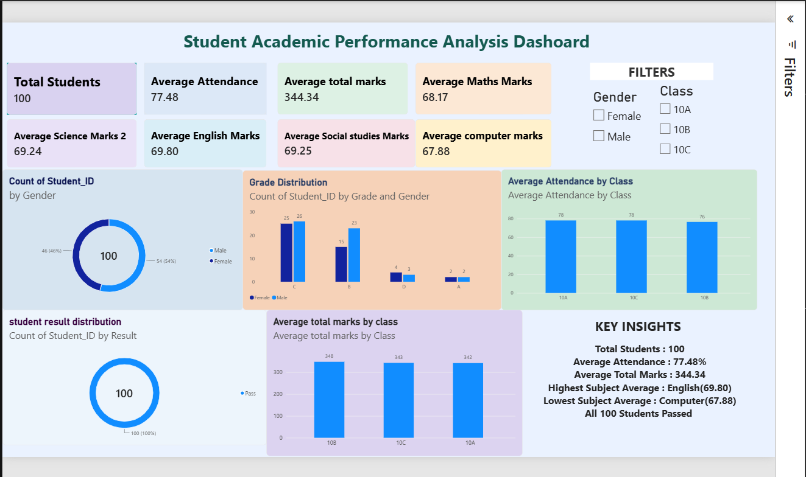

# Student Academic Performance Analysis

An interactive Power BI dashboard for exploring student attendance, subject marks, grades, and results across three classes.



## Project overview

This project summarizes a student performance dataset with 100 records. The dashboard provides summary cards, gender and grade distributions, class comparisons, and filters for gender and class.

### Highlights

- 100 students are included; all 100 are marked **Pass** in the supplied dataset.
- Average attendance is **77.48%**.
- Average total marks are **344.34** out of 500.
- English has the highest subject average (**69.80**); Computer has the lowest (**67.88**).
- Class 10B has the highest average total marks (**347.68**); class 10A has the highest average attendance (**78.07%**).

These figures were calculated from the included CSV and rounded to two decimal places.

## Dashboard features

- KPI cards for student count, attendance, total marks, and subject averages
- Student count by gender
- Grade distribution by gender
- Average attendance by class
- Result distribution
- Average total marks by class
- Gender and class filters

## Repository contents

```text
Student_Academic_Performance_Analysis/
├── README.md
├── data/
│   └── student_performance_dataset.csv
├── docs/
│   └── DATA_DICTIONARY.md
└── images/
    └── dashboard.png
```

## Dataset

The CSV contains student identifiers, names, gender, class, attendance percentage, five subject marks, total marks, average marks, grade, and result. See [the data dictionary](docs/DATA_DICTIONARY.md) for field descriptions.

To use it in Power BI Desktop, choose **Get data → Text/CSV** and select `data/student_performance_dataset.csv`.

## Power BI report file

The dashboard image is included as a visual reference. The editable Power BI `.pbix` file was not provided, so this repository package does not include the report source file.

## Tools

- Microsoft Power BI for dashboarding
- CSV dataset for the source data

## Notes

The summary describes the supplied dataset and screenshot. It does not establish that the records represent a real-world population. The project currently documents descriptive analysis; it does not make causal claims.
